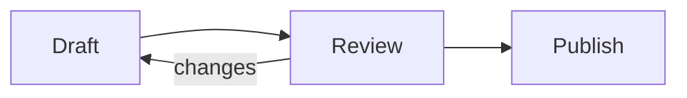

# Mermaid diagrams

Writer Computer draws Mermaid diagrams inside your notes. Write the diagram in a fenced code block whose language is `mermaid`:

````markdown

````

When the caret is outside the block, you see the diagram. Click the code button in its top-right corner to edit the source, which opens above the diagram.

<video src="/demo-videos/03.mp4" autoplay muted loop playsinline preload="metadata" aria-label="Scrolling through rendered Mermaid diagrams in Writer Computer: entity-relationship, Gantt, state and sequence."></video>

## Supported diagram types

Every diagram type built into Mermaid 12.1:

- Flowchart, sequence, class and state diagrams
- Entity-relationship and requirement diagrams
- Gantt charts, timelines and kanban boards
- Pie, XY, quadrant, radar, Sankey and treemap charts
- User journeys, mindmaps and git graphs
- Block, architecture, C4 and packet diagrams

Writer draws diagrams with [Pele](https://pele.run), so a diagram's layout can differ from the one on mermaid.live.

## Working with a diagram

- **Pan and zoom.** Drag to pan. Pinch, or scroll with ⌘ held, to zoom. The buttons in the bottom-right corner zoom in, zoom out and fit the diagram back into view.
- **Full screen.** The expand button opens the diagram in a window-sized view with the same pan and zoom.
- **Keyboard.** Focus the diagram, then use the arrow keys to pan, `+` and `-` to zoom, `0` to fit and Enter to edit the source.
- **Theme.** Colors follow the light or dark theme, the accent color and the Contrast setting, and change as soon as you change them.
- **Errors.** A diagram that can't be drawn shows "Can't draw this diagram" with the reason. For a syntax error, that includes the line and column.
- **Links.** `click` links in a diagram are shown as text and aren't followed.
